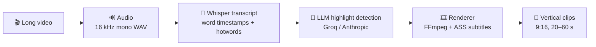

# AI Viral Clip Maker

Turn one long video into a batch of **vertical, subtitled, fast-paced clips** ready for
YouTube Shorts, TikTok and Instagram Reels — automatically.

The tool transcribes the video with Whisper, asks an LLM to find the most engaging
moments, and renders each one as a 1080×1920 clip with animated word-by-word subtitles,
a hook title, punch-in zooms, smart jump cuts and normalized loudness. Every step runs
locally except the LLM call.

> ⚠️ Only process videos you own or have explicit permission to use.

---

## Pipeline



| Stage | Module | Output |
|---|---|---|
| Inspect video | `src/video_info.py` | `data/video_info.json` |
| Extract audio | `src/audio_extractor.py` | `data/audio.wav` |
| Transcribe | `src/transcriber.py` | `data/transcript.json` / `.txt` (word-level timestamps) |
| Find highlights | `src/highlights.py` + `src/llm.py` | `data/highlights.json` (editable) |
| Render clips | `src/render.py` + `src/renderer.py` + `src/editing.py` + `src/subtitles.py` | `output/<version>/*.mp4`, `clips_summary.md` |

## Features

- **Accurate transcription.** faster-whisper `medium` by default, with a glossary of names and
  slang passed as **hotwords**. CUDA float16 when a GPU is available, otherwise int8 on CPU.
- **Configurable LLM provider.** Groq (`openai/gpt-oss-120b`, default) or Anthropic, chosen with one
  `.env` variable. All callers go through `src.llm.complete()`, so the rest of the code does not
  depend on the provider.
- **Sentence-aware moments.** Each clip starts at the beginning of a sentence and ends at the end of
  one, and lasts 20–60 s. Overlapping and mostly silent moments are dropped automatically.
- **Smart jump cuts.** Silences between words are removed only where the audio is actually quiet.
  Loud gaps such as driving, shooting or music are kept.
- **Audio crossfades.** A 40 ms crossfade at every cut, with cuts snapped to whole frames so audio and video stay in sync.
- **Animated word-by-word subtitles.** UPPERCASE words pop in as they are spoken. The current word is
  yellow, names are green and strong words are red. Lines are laid out from the start, so words never move.
- **Hook titles.** A one-line hook pops in for the first 2.5 s and fades out. Long hooks are
  shrunk to fit, measured with the system font engine.
- **Punch-in zooms.** Framing alternates between 1.00, 1.12 and 1.05 and changes on jump cuts to hide them. There are
  extra short punches on the loudest peaks.
- **Progress bar** that fills over the clip.
- **Loudness normalization** to −14 LUFS, the level the short-video platforms use.
- **Human in the loop.** `highlights.json` is plain JSON. You can fix a subtitle word, hook or time range,
  then re-render a single clip with `--clip N`.
- **Safe re-runs.** The tool asks before overwriting, and `--skip-existing` reuses finished steps. Backups are made before
  highlights are edited, and clip numbers are fixed in a manifest.

## Tech stack

| Area | Tools |
|---|---|
| Language | Python 3.10–3.13 |
| Speech-to-text | [faster-whisper](https://github.com/SYSTRAN/faster-whisper) (CTranslate2) |
| LLM | Groq API (`gpt-oss-120b`) or Anthropic API, with strict JSON output |
| Video / audio | FFmpeg + FFprobe (filter graphs, `loudnorm`, `acrossfade`, libx264 / AAC) |
| Subtitles | Advanced SubStation Alpha (`.ass`) with karaoke-style override tags |
| CLI / UX | `argparse`, [rich](https://github.com/Textualize/rich), `python-dotenv` |

## Setup (Windows, PowerShell)

1. **Install FFmpeg** (ffmpeg + ffprobe):

   ```powershell
   winget install Gyan.FFmpeg
   ```

   Open a **new** terminal afterwards. If FFmpeg is still not found, set `FFMPEG_DIR` to the folder
   that contains `ffmpeg.exe`. The winget install folder is also checked automatically.

2. **Create the Python environment:**

   ```powershell
   git clone https://github.com/erbolka25/ai-viral-clip-maker.git
   cd ai-viral-clip-maker
   py -3.13 -m venv .venv
   .venv\Scripts\Activate.ps1
   pip install -r requirements.txt
   # pip install anthropic      # only if you use LLM_PROVIDER=anthropic
   ```

3. **Add your API key:**

   ```powershell
   Copy-Item .env.example .env
   notepad .env                 # set GROQ_API_KEY (free key: https://console.groq.com/keys)
   python -m src.llm            # sanity check: prints model, latency, tokens, rate limits
   ```

4. **Add your video** as `input\gta6.mp4`. The path is set by `INPUT_VIDEO` in `src/config.py`.

5. *(Optional)* Add names and terms Whisper should spell correctly to `glossary.txt`, one per line.

## Usage

```powershell
.venv\Scripts\Activate.ps1

python -m src.main              # 1. video info -> audio -> transcript
python -m src.highlights        # 2. LLM picks 10-15 moments -> data\highlights.json
python -m src.render            # 3. render the top 10 -> output\v3\*.mp4 + clips_summary.md
```

### Common commands

| Command | Effect |
|---|---|
| `python -m src.main --model small` | Faster, less accurate transcription (`tiny` … `large-v3`) |
| `python -m src.main --language en` | Force the source language instead of auto-detecting it |
| `python -m src.main --skip-existing` | Reuse finished steps and run only missing ones |
| `python -m src.main --no-glossary` | Transcribe without hotwords |
| `python -m src.highlights -y` | Re-detect highlights and overwrite `highlights.json` |
| `python -m src.highlights --more` | Ask for up to 10 **new**, non-overlapping moments with a score of at least 7 |
| `python -m src.highlights --fix-boundaries` | Snap existing moments to sentence boundaries (keeps your edits, makes a backup) |
| `python -m src.render --top 5` | Render only the 5 best moments |
| `python -m src.render --clip 3` | Re-render clip 3 after editing `highlights.json` |
| `python -m src.render --new` | Render moments that are not clips yet as the next clip numbers |
| `python -m src.render --test` | Render the top moment and 3 preview frames to `data\test\` |
| `python -m src.compare_models --models small medium` | Compare Whisper models on short excerpts |

### Fixing a clip

1. Find the clip number in `output\v3\clips_summary.md`.
2. In `data\highlights.json`, edit that moment's `words` (subtitle text), `hook_title`, `start` or `end`.
3. Run `python -m src.render --clip N`.

## Configuration

Secrets and the provider live in `.env`. It is git-ignored; see `.env.example`:

```ini
LLM_PROVIDER=groq            # or: anthropic
GROQ_API_KEY=...
ANTHROPIC_API_KEY=...        # only for anthropic
```

Everything else is in [`src/config.py`](src/config.py):

| Setting | Default | Purpose |
|---|---|---|
| `WHISPER_MODEL` | `medium` | Whisper model size |
| `LLM_MODELS` | `gpt-oss-120b` / `claude-opus-5-5` | Model per provider |
| `GROQ_REASONING_EFFORT` | `medium` | Reasoning effort for gpt-oss |
| `MOMENT_MIN_SECONDS` / `MAX` | `20` / `60` | Clip length before cuts |
| `RENDER_VERSION` | `v3` | Output subfolder, so earlier versions are kept |
| `EDIT_JUMP_CUTS` | on | Remove pauses longer than `JUMP_CUT_MIN_SILENCE` (0.5 s) |
| `JUMP_CUT_SMART` | on | Cut only stretches quieter than `JUMP_CUT_QUIET_DB` (−42 dBFS) |
| `JUMP_CUT_IGNORE_BURST` | `0.3` s | Short loud bursts (footsteps, clicks) don't count as action |
| `JUMP_CUT_MIN_PIECE` | `1.2` s | Never leave a kept piece shorter than this |
| `AUDIO_CROSSFADE` | `0.04` s | Crossfade at every cut (0 = hard cut) |
| `EDIT_PUNCH_ZOOMS` | on | Alternating zoom levels every 3.5 s, otherwise a slow 1.00 → 1.08 zoom |
| `EDIT_PEAK_PUNCH` | on | Up to 3 short punch-ins on loudness peaks |
| `EDIT_ANIMATED_SUBS` | on | Pop-in words, uppercase, keyword colours |
| `SUB_STABLE_LAYOUT` | on | Pre-laid-out lines so words never move |
| `EDIT_HOOK_ANIMATION` / `HOOK_DURATION` | on / `2.5` s | Animated hook title |
| `EDIT_PROGRESS_BAR` | on, `top` | Progress bar position and height |
| `EDIT_CLEAN_ENDING` / `END_PAD` | on / `0.3` s | End the clip shortly after the last word |

`SOURCE_SUBTITLE_BAND` in `src/renderer.py` blurs a band of burned-in subtitles in the source.
Set it to `None` for a clean source.

## Design decisions

### Hotwords instead of `initial_prompt`

Whisper decodes audio in 30-second windows. An `initial_prompt` only conditions the **first** window.
After that, the model conditions on its own previous output, so a misspelled name keeps getting
misspelled. faster-whisper's `hotwords` are added in front of **every** window, so glossary terms
work across the whole video. `src.compare_models` was built to check this on real excerpts
before switching the default.

### Loudness-based jump cuts

Cutting every gap between spoken words works for talking-head videos, but it ruins gameplay and
action footage. The best moments often have no speech at all: a car chase, a shootout, a music
drop. The smart cutter measures the audio in 50 ms windows and removes only stretches that are
quiet the whole time. Short bursts such as footsteps are ignored, so they don't save a boring pause. Cuts that would leave
a fragment shorter than 1.2 s are skipped, which avoids a choppy look.

### Words are attached in code, not by the LLM

The LLM only returns **time ranges** and creative metadata: title, category, score, reason and hook.
The exact words and their timestamps are then copied from `transcript.json` **in code**.
This has three benefits:

- **No hallucinated subtitles.** LLMs paraphrase, "fix" grammar and drop words. Subtitles must match the audio exactly.
- **Fewer tokens.** Returning thousands of timestamped words would cost much more output and
  break the Groq free-tier limit (~8K tokens/min).
- **Deterministic validation.** Code snaps boundaries to words and sentences, enforces 20–60 s,
  removes overlaps and drops silent moments. The model's output never has to be perfect.

## Project structure

```
src/
  config.py           paths and every tunable setting
  deps.py             FFmpeg / package discovery
  video_info.py       FFprobe inspection
  audio_extractor.py  16 kHz mono WAV extraction
  transcriber.py      faster-whisper transcription with hotwords
  compare_models.py   model / glossary comparison on short excerpts
  main.py             stage 1 CLI (info -> audio -> transcript)
  llm.py              provider-neutral LLM call (Groq / Anthropic)
  highlights.py       highlight detection, validation, sentence boundaries
  editing.py          smart jump cuts, zoom plan, peak detection
  subtitles.py        animated .ass subtitles and hook title
  renderer.py         FFmpeg 9:16 render of one clip
  render.py           batch / single-clip render CLI
glossary.txt          hotwords for Whisper
.env.example          template for secrets
```

`input/`, `data/` and `output/` are created at runtime and are git-ignored.

## Limitations

- **Speech-driven selection.** Highlights are chosen from the transcript only. A great visual moment
  with no dialogue can be missed.
- **Center crop.** The 9:16 frame is a fixed center crop, so action at the edges of a 16:9 frame can be cut off.
- **CPU speed.** `medium` on CPU takes roughly as long as the video itself. A GPU is much faster.
- **One video at a time.** The input path is fixed in `config.py`.
- **Free-tier rate limits.** Long transcripts are split into overlapping chunks to stay under Groq's
  tokens-per-minute limit, which makes detection slower.

## Roadmap

- [ ] **Streamlit dashboard** to preview moments, edit subtitles and hooks, and re-render in the browser.
- [ ] **Visual analysis** using scene-change detection, motion energy and a vision model, to score moments
      without dialogue and to track the subject instead of center-cropping.
- [ ] **Faster transcription** with `large-v3-turbo`, batched inference and GPU-first defaults.
- [ ] Input video as a CLI argument and batch processing of several videos.
- [ ] Optional translated subtitles.

## Responsible use

This tool edits existing footage. Only process videos you created yourself or have explicit
permission to use, and follow each platform's rules on reused content.

## License

[MIT](LICENSE) © 2026 Erbolbek
